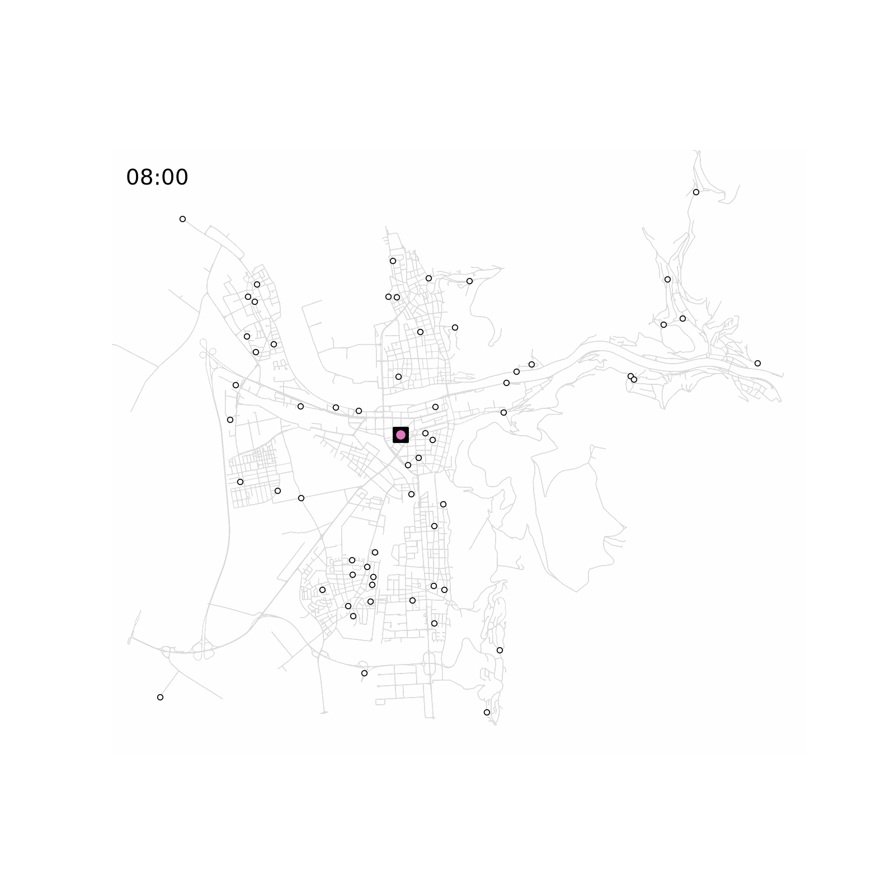
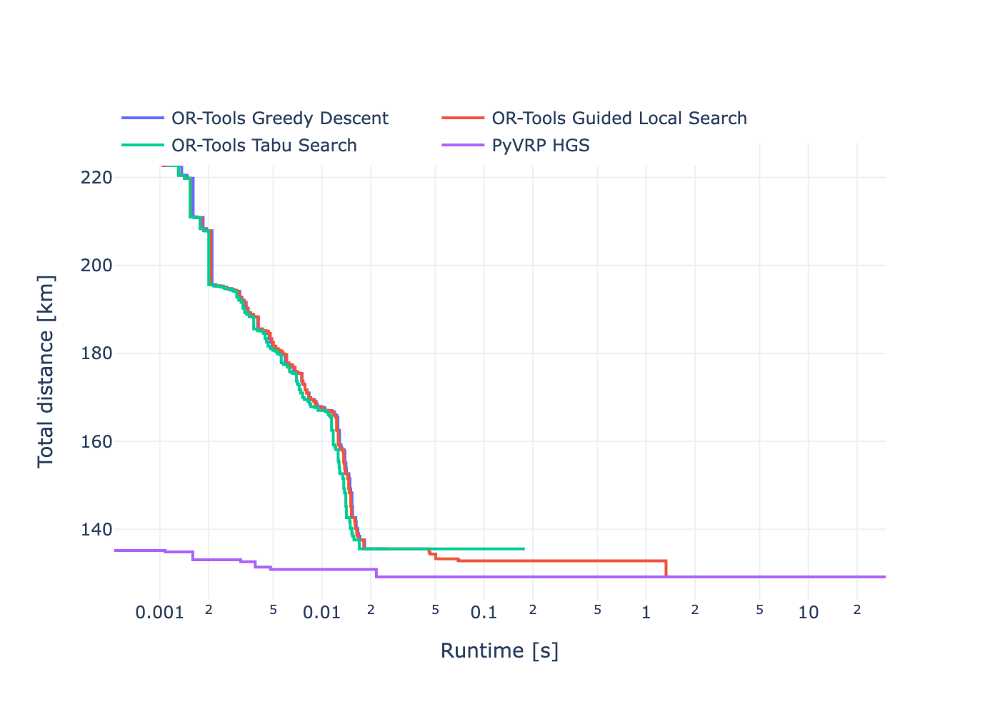
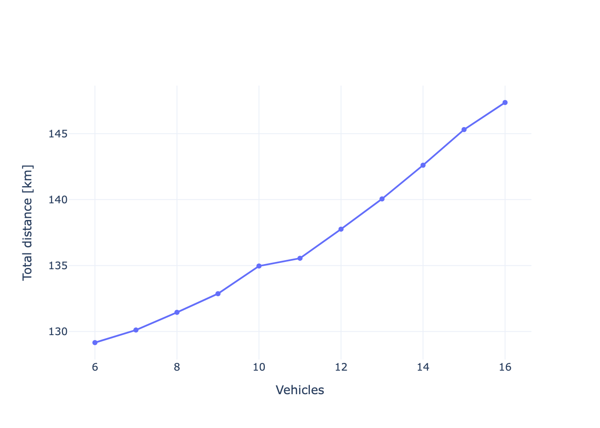
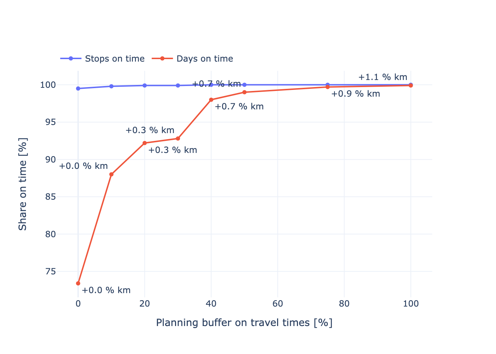

# City Route Optimizer

Vehicle routing with capacities and time windows on the real street network of Heidelberg.
A delivery fleet leaves a central depot, serves customers placed on OpenStreetMap buildings and
returns, minimising total driven distance.



## Approach

1. Drivable street network from OpenStreetMap (`osmnx`), restricted to its largest strongly connected component.
2. Customers sampled from building centroids and placed at the nearest point on a street (the edge is split there, two-way streets in both directions), each with a demand and a one- or two-hour delivery window.
3. Fastest paths via Dijkstra on a sparse adjacency matrix (`scipy.sparse.csgraph`), one source per site; the distance matrix holds the length of exactly these paths.
4. Constructive baselines: Nearest Neighbor, Clarke-Wright Savings with Yellow's shape parameter λ, Solomon's I1 insertion for time windows.
5. Search: OR-Tools (greedy descent, Guided Local Search, Tabu Search) and PyVRP's Hybrid Genetic Search.
6. Exact reference: CP-SAT with a multiple-circuit formulation, warm-started by HGS, proves optimality up to 60 customers.
7. Robustness: plans built with a travel-time buffer are replayed under random and under time-of-day travel times.
8. Routes are mapped back onto the streets, simplified with Douglas-Peucker and animated.

## Results

Heidelberg, 60 customers, 8 vehicles, 30 s per search method. `gap_pct` is the distance above the
CP-SAT lower bound, so 0 means proven optimal. The baselines ignore the fleet limit, and Nearest
Neighbor and Savings ignore time windows, hence the separate CVRP block.

<!-- comparison -->
| problem | method | distance_km | gap_pct | vehicles | runtime_s |
| --- | --- | --- | --- | --- | --- |
| CVRP | Nearest Neighbor | 142.71 | 43.45 | 6 | 0.0 |
| CVRP | Clarke-Wright Savings | 103.38 | 3.91 | 6 | 0.01 |
| CVRP | OR-Tools Greedy Descent | 106.35 | 6.89 | 6 | 0.01 |
| CVRP | OR-Tools Guided Local Search | 99.49 | 0.0 | 6 | 30.0 |
| CVRP | PyVRP HGS | 99.49 | 0.0 | 6 | 30.0 |
| VRPTW | Solomon I1 | 170.7 | 32.16 | 6 | 0.01 |
| VRPTW | OR-Tools Greedy Descent | 135.53 | 4.93 | 7 | 0.03 |
| VRPTW | OR-Tools Guided Local Search | 129.16 | 0.0 | 6 | 30.0 |
| VRPTW | OR-Tools Tabu Search | 135.53 | 4.93 | 7 | 0.18 |
| VRPTW | PyVRP HGS | 129.16 | 0.0 | 6 | 30.0 |
<!-- /comparison -->




Forcing more vehicles onto the road than the six needed costs about 1.8 km per extra vehicle.

Multi-instance study: 40, 60 and 100 customers × 10 seeds, 10 s per run. Gap to the best solution found
for each instance; the primal integral is the time-averaged gap (Berthold 2013) and measures how fast a
method gets good. HGS finds the best solution on all 30 instances; its advantage over GLS is
significant for both the final gap and the primal integral (paired Wilcoxon signed-rank test,
p = 0.0001 and p < 0.0001). Solomon I1 is far off in distance but uses about one vehicle fewer,
because it fills routes before opening new ones.

<!-- study -->
| customers | method | gap_mean_pct | gap_max_pct | integral_mean_pct | best_found |
| --- | --- | --- | --- | --- | --- |
| 40 | OR-Tools GLS | 0.0 | 0.01 | 0.19 | 9 |
| 40 | PyVRP HGS | 0.0 | 0.0 | 0.01 | 10 |
| 40 | Solomon I1 | 27.22 | 53.06 | 20.95 | 0 |
| 60 | OR-Tools GLS | 0.38 | 1.59 | 1.16 | 3 |
| 60 | PyVRP HGS | 0.0 | 0.0 | 0.02 | 10 |
| 60 | Solomon I1 | 24.3 | 32.21 | 19.56 | 0 |
| 100 | OR-Tools GLS | 3.22 | 4.98 | 4.96 | 0 |
| 100 | PyVRP HGS | 0.0 | 0.0 | 0.2 | 10 |
| 100 | Solomon I1 | 27.45 | 35.84 | 21.68 | 0 |
<!-- /study -->

Optimality gap against CP-SAT on 20, 40, 60 and 100 customers × 5 seeds, 5 s per heuristic and up to
120 s for CP-SAT, warm-started with the HGS solution. Up to 60 customers CP-SAT proves the optimum
within 15 s and HGS hits it every time. At 100 customers the bound does not close, so the 3.2 % is an
upper limit on the HGS gap, not the gap itself.

<!-- exact -->
| customers | method | gap_mean_pct | gap_max_pct | optimal |
| --- | --- | --- | --- | --- |
| 20 | CP-SAT | 0.0 | 0.0 | 5 |
| 20 | OR-Tools Guided Local Search | 0.0 | 0.0 | 5 |
| 20 | PyVRP HGS | 0.0 | 0.0 | 5 |
| 20 | Solomon I1 | 26.54 | 55.94 | 0 |
| 40 | CP-SAT | 0.0 | 0.0 | 5 |
| 40 | OR-Tools Guided Local Search | 0.0 | 0.0 | 5 |
| 40 | PyVRP HGS | 0.0 | 0.0 | 5 |
| 40 | Solomon I1 | 24.65 | 36.88 | 0 |
| 60 | CP-SAT | 0.0 | 0.0 | 5 |
| 60 | OR-Tools Guided Local Search | 0.06 | 0.3 | 3 |
| 60 | PyVRP HGS | 0.0 | 0.0 | 5 |
| 60 | Solomon I1 | 25.02 | 32.16 | 0 |
| 100 | CP-SAT | 3.19 | 3.72 | 0 |
| 100 | OR-Tools Guided Local Search | 6.9 | 10.56 | 0 |
| 100 | PyVRP HGS | 3.19 | 3.72 | 0 |
| 100 | Solomon I1 | 31.93 | 40.12 | 0 |
<!-- /exact -->

Solomon's 56 benchmark instances with 100 customers, 30 s per run, against the best known solutions
listed by [SINTEF](https://www.sintef.no/projectweb/top/vrptw/solomon-benchmark/100-customers/).
Those minimise vehicles first, then distance; a fixed cost per vehicle larger than any total distance
reproduces that order. `extra_vehicles` sums the vehicles above the best known count, the gaps cover
the instances solved with the best known count.

<!-- solomon -->
| group | method | instances | extra_vehicles | gap_mean_pct | gap_max_pct |
| --- | --- | --- | --- | --- | --- |
| C1 | OR-Tools GLS | 9 | 0 | 1.7 | 6.84 |
| C1 | PyVRP HGS | 9 | 0 | 0.0 | 0.0 |
| C2 | OR-Tools GLS | 8 | 0 | 0.0 | 0.0 |
| C2 | PyVRP HGS | 8 | 0 | 0.0 | 0.0 |
| R1 | OR-Tools GLS | 12 | 10 | 1.92 | 3.67 |
| R1 | PyVRP HGS | 12 | 2 | 0.32 | 1.32 |
| R2 | OR-Tools GLS | 11 | 4 | 2.76 | 5.89 |
| R2 | PyVRP HGS | 11 | 0 | 0.58 | 3.26 |
| RC1 | OR-Tools GLS | 8 | 11 | 4.21 | 4.21 |
| RC1 | PyVRP HGS | 8 | 1 | 0.16 | 0.54 |
| RC2 | OR-Tools GLS | 8 | 1 | 3.19 | 5.91 |
| RC2 | PyVRP HGS | 8 | 0 | 0.32 | 1.38 |
<!-- /solomon -->

Robustness to uncertain travel times: 60 customers, 10 vehicles, 5 seeds. Each plan is built by HGS
on travel times inflated by a buffer and then driven 2000 times with lognormal travel times (mean as
in the network, coefficient of variation 0.3, half of the variance shared by all legs of a day). A
stop is on time if service starts within its window; a day is on time if every stop is. Because the
windows are one to two hours wide, punctuality is cheap: planning with 30 % longer travel times lifts
fully punctual days from 73 % to 93 % for 0.3 % more distance, 50 % reaches 99 % for 0.7 %.

<!-- robust -->
| buffer_pct | instances | extra_km_pct | vehicles | stops_on_time_pct | days_on_time_pct | late_min |
| --- | --- | --- | --- | --- | --- | --- |
| 0 | 5 | 0.0 | 6.6 | 99.5 | 73.4 | 2.0 |
| 10 | 5 | 0.0 | 6.6 | 99.8 | 88.0 | 1.8 |
| 20 | 5 | 0.3 | 6.6 | 99.9 | 92.2 | 1.9 |
| 30 | 5 | 0.3 | 6.6 | 99.9 | 92.8 | 1.3 |
| 40 | 5 | 0.7 | 6.6 | 100.0 | 98.0 | 1.5 |
| 50 | 5 | 0.7 | 6.6 | 100.0 | 99.0 | 0.6 |
| 75 | 5 | 0.9 | 6.8 | 100.0 | 99.7 | 0.8 |
| 100 | 5 | 1.1 | 7.0 | 100.0 | 99.9 | 0.4 |
<!-- /robust -->



Time-of-day traffic: 60 customers, 10 vehicles, 10 seeds. Travel is 40 % slower until 09:30 and 30 %
slower from 15:00, modelled as piecewise-constant speed so that leaving later never means arriving
earlier (Ichoua et al. 2003). Neither solver supports time-dependent travel times, so three plans
built on fixed times are driven through this profile: free-flow times, the peak factor on every leg,
and for each leg the slowest travel time over the departures its origin's time window allows. The last
one is guaranteed punctual and costs 0.08 % distance instead of 0.53 %. With windows this wide even
the free-flow plan is late in only one of ten instances, by under three minutes.

<!-- traffic -->
| plan | instances | extra_km_pct | vehicles | plans_with_delay | late_stops_pct | max_late_min |
| --- | --- | --- | --- | --- | --- | --- |
| Free-flow times | 10 | 0.0 | 6.7 | 1 | 0.15 | 2.83 |
| Peak factor everywhere | 10 | 0.53 | 6.7 | 0 | 0.0 | 0.0 |
| Worst case per departure window | 10 | 0.08 | 6.7 | 0 | 0.0 | 0.0 |
<!-- /traffic -->

## Usage

```bash
uv sync
uv run pytest
uv run python benchmarks/city.py
uv run python benchmarks/study.py
uv run python benchmarks/exact.py
uv run python benchmarks/solomon.py
uv run python benchmarks/robust.py
uv run python benchmarks/traffic.py
uv run streamlit run app/streamlit_app.py
```

## Structure

```
src/cityroute/   network, scenario, solve, heuristics, robust, traffic, viz
app/             Streamlit what-if planner
benchmarks/      city comparison, multi-instance study, exact gaps, Solomon instances, robustness, traffic
tests/           feasibility, optimality and path checks
assets/          figures and animation
```

## License

MIT
